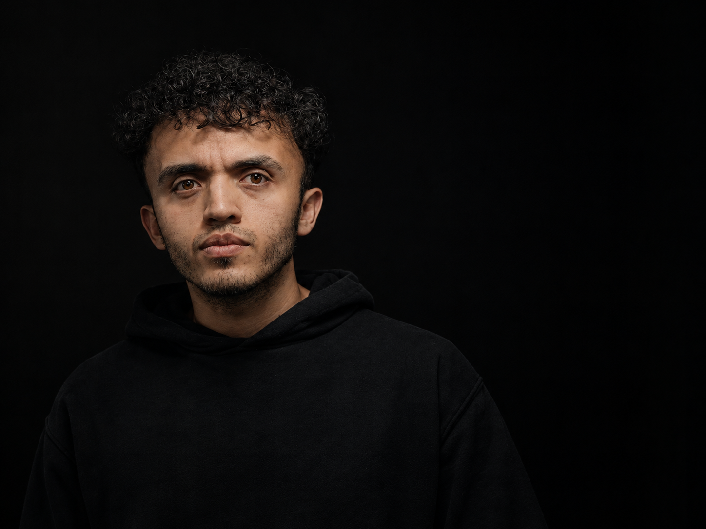

# Ivo Thaiel Vicencio Rosas

### Software Engineer · Full Stack · IA

[Portfolio](https://ivovicencio-portfolio.vercel.app/) · [LinkedIn](https://www.linkedin.com/in/ivo-vicencio-rosas-7aaa44211/) · [Email](mailto:ivothaielvicencio@gmail.com)

📍 Jujuy, Argentina · 🟢 Abierto a oportunidades

---

## Sobre mí

Soy **Analista Programador Universitario** y desarrollador de software. Me interesa crear aplicaciones y sistemas a medida que resuelvan problemas reales: desde una buena arquitectura y APIs hasta productos web con integraciones de IA.

Trabajo principalmente con **Java y Spring Boot, C#/.NET, Angular, React, Node.js y Python**. También tengo experiencia con bases de datos relacionales y NoSQL, Docker, Linux y metodologías ágiles. Priorizo el código claro, mantenible y pensado para crecer.

## Experiencia

- **Desarrollador Backend — Sistema de gestión de paquetería** · 2025 
  API REST con Java y Spring Boot, arquitectura en capas, relaciones entre entidades y autenticación con JWT.
- **Desarrollador Full Stack — Sistema de turnos para clínica dental** · 2025 
  Sistema colaborativo con roles para administración, profesionales y pacientes, más un panel de gestión.

## Proyectos

- **[CVOLVE](https://cvolve-lime.vercel.app/)** — Aplicación web que adapta un CV a una oferta laboral con IA y exporta a DOCX/PDF. [Código fuente](https://github.com/ivovicencio/AI-powered-CV) · Angular · TypeScript · Express · Groq
- **[DentalTurnos](https://registrar-turno-sistema-clinico.onrender.com/)** — Sistema colaborativo de turnos e historias clínicas para consultorios odontológicos. [Frontend](https://github.com/GabrielIturreCs/Registrar-Turno-Sistema-Clinico) · [Backend](https://github.com/GabrielIturreCs/SistemaConsultorioBackend) · Angular · Node.js · MongoDB
- **[Asistente de voz](https://github.com/ivovicencio/jarvis1.0)** — Asistente activado por voz y palmadas, con comandos, control de aplicaciones e integración con IA. Python · Groq · SpeechRecognition · MediaPipe
- **[PDF RAG Assistant](https://github.com/ivovicencio/pdf-rag-assistant)** — Búsqueda semántica y consultas sobre documentos PDF. Python · LangChain · ChromaDB · Groq
- **Otros:** sistemas de gestión para ópticas y talleres en .NET, y **SheetDiff**, una herramienta en Python para comparar planillas.

## Stack

- **Lenguajes:** Java · C# · TypeScript · JavaScript · Python · C++
- **Frontend:** Angular · React · HTML · CSS · Bootstrap · Tailwind CSS
- **Backend:** Spring Boot · .NET · Node.js · Express · APIs REST
- **Datos:** PostgreSQL · MySQL · MongoDB · SQLite · Redis
- **Herramientas:** Docker · Git · Linux · GitHub · GitLab · Railway · Vercel
- **IA:** LangChain · RAG · Groq · ChromaDB · integración de modelos

## Formación e idiomas

- **Analista Programador Universitario** — Universidad Nacional de Jujuy · 2023–2026
- **Español:** nativo · **Inglés:** B2 (intermedio alto, Cambridge KET y PET)

---

**¿Tenés un proyecto o una oportunidad?** [Hablemos](mailto:ivothaielvicencio@gmail.com)

